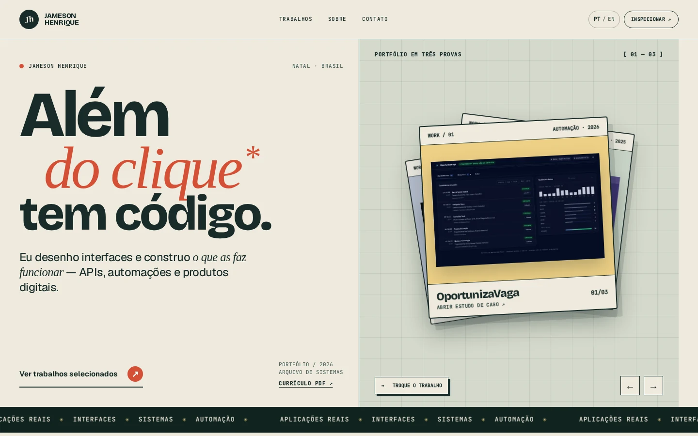
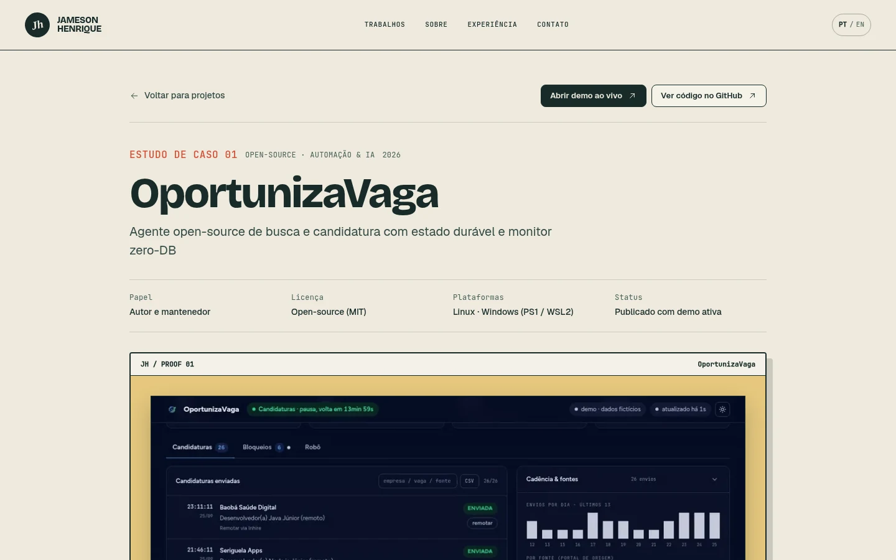

# Portfólio | Jameson Henrique

[](https://github.com/JamesonHenrique/Portfolio/actions/workflows/ci.yml)

**Além do clique tem código.** Meu portfólio reúne interfaces e os sistemas por trás delas. Sou desenvolvedor full stack e responsável por tecnologia na Wolfacilitates C&M, curso Bacharelado em Tecnologia da Informação no IMD/UFRN e trabalho com Java, Spring Boot, Angular e TypeScript.

[Portfólio em português](https://jamesonhenrique-portfolio.vercel.app/) · [Portfolio in English](https://jamesonhenrique-portfolio.vercel.app/en)



## O que tem no site

- **Seletor de projetos** com capturas dos produtos, navegação por botões, teclado e gesto horizontal.
- **Animações** na entrada do título, nas capturas conforme a rolagem e na transição para os estudos de caso. Os efeitos respeitam a preferência por movimento reduzido.
- **Apresentação e contato** com bio, três experiências profissionais, currículo em PDF, links profissionais e cópia de e-mail.

<p>
  
</p>

## Estudos de caso

| Projeto | O que a página mostra |
| --- | --- |
| [OportunizaVaga](https://jamesonhenrique-portfolio.vercel.app/projetos/oportunizavaga) | Agente open-source de busca e candidatura a vagas, com registro persistente e monitor web. A demonstração pública usa dados fictícios. |
| [Painel de Máquinas](https://jamesonhenrique-portfolio.vercel.app/projetos/painel-de-maquinas) | Interface de monitoramento de equipamentos em tempo real e estados operacionais no chão de fábrica. |
| [Newgram](https://jamesonhenrique-portfolio.vercel.app/projetos/newgram) | Rede social full stack com backend em camadas, contrato OpenAPI e armazenamento de mídia no AWS S3. |



## Stack e arquitetura

- **Angular 22 e TypeScript 6** com componentes standalone, signals e detecção de mudanças zoneless.
- **SCSS e Tailwind CSS 3** com os tokens da identidade visual em `portfolio/src/styles.scss` e fontes servidas pelo próprio site.
- **Oito rotas pré-renderizadas**, com a página inicial e os três estudos de caso em português e inglês. O HTML gerado inclui texto, links e metadados antes da hidratação.
- **SEO por rota** com título, descrição, canonical, `hreflang`, Open Graph e JSON-LD. O sitemap e o `robots.txt` são servidos junto com o site.
- **GitHub Actions** executa lint, formatação, testes unitários, build, Playwright e Gitleaks. A **Vercel** hospeda a produção a partir da branch `main`.

## Rodando localmente

Use Node.js 24 e npm.

```bash
cd portfolio
npm ci
npm start                 # http://localhost:4200
```

### Verificações

```bash
npm run lint
npm run format:check
npm run test:ci           # testes unitários com Chrome Headless
npm run build             # gera dist/jh-portfolio/browser
npm run e2e               # Playwright em desktop e mobile, após o build
```

O Playwright usa o Chrome instalado na execução local. A CI instala o Chromium para sua execução.

## Onde editar

| Conteúdo | Arquivo |
| --- | --- |
| Textos e estudos de caso em português | [`portfolio/src/app/content/pt.ts`](portfolio/src/app/content/pt.ts) |
| Tradução em inglês | [`portfolio/src/app/content/en.ts`](portfolio/src/app/content/en.ts) |
| Rotas | [`portfolio/src/app/app.routes.ts`](portfolio/src/app/app.routes.ts) |
| Metadados por rota | [`portfolio/src/app/services/seo.service.ts`](portfolio/src/app/services/seo.service.ts) |
| Currículo, favicon, ícones e cartão de compartilhamento | [`portfolio/public/`](portfolio/public/) |
| Capturas deste README | [`docs/`](docs/) |

Ao trocar de domínio, atualize `SITE_ORIGIN` em `portfolio/src/app/content/types.ts` e as URLs absolutas em `portfolio/src/index.html`, `portfolio/public/robots.txt` e `portfolio/public/sitemap.xml`.

## Contato

- [E-mail](mailto:jameson.henrique.dev@gmail.com)
- [LinkedIn](https://www.linkedin.com/in/jamesonhenrique/)
- [GitHub](https://github.com/JamesonHenrique)
