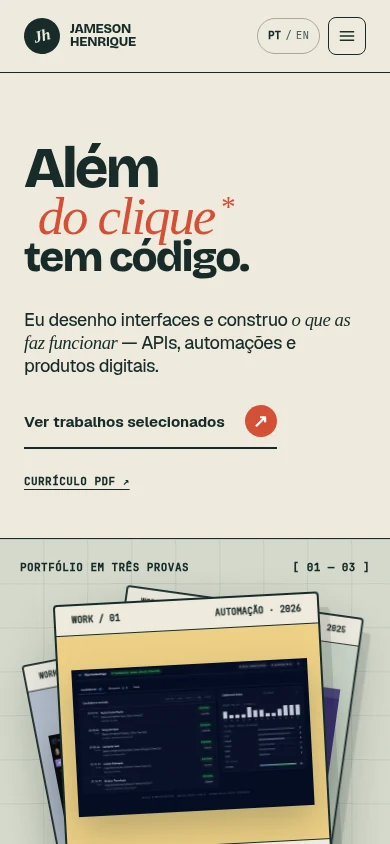

# Portfólio | Jameson Henrique

[](https://github.com/JamesonHenrique/Portfolio/actions/workflows/ci.yml)

Desenvolvedor Full Stack e Responsável por Tecnologia na **Wolfacilitates C&M** desde novembro de 2026 e estudante de BTI na UFRN. Base em **Java/Spring Boot e Angular/TypeScript**, com experiência anterior em automação e integração de sistemas. Este é o código do meu site pessoal.

**No ar:** https://jamesonhenrique-portfolio.vercel.app/


## O que tem no site

| Seção | Conteúdo |
|---|---|
| Projetos | Três estudos de caso com página própria (`OportunizaVaga`, `Painel de Máquinas` e `Newgram`), além de arquivo com outros repositórios públicos |
| Sobre e trajetória | Apresentação, formação no IMD/UFRN, linha do tempo profissional e acesso ao currículo em PDF |
| Capacidades | Competências técnicas organizadas por contexto de uso (backend/APIs/dados, frontend, automação/integrações/IA e testes/infraestrutura) |
| Inglês | Versão completa em `/en`, com `hreflang` entre os idiomas e 8 rotas pré-renderizadas (`/`, `/en`, `/projetos/*` e `/en/projects/*`) |
| Contato | Formulário (FormSubmit via AJAX, com honeypot), e-mail, telefone e redes |

<p>
  
</p>

## Stack do site

- **Angular 22**: componentes standalone, signals, `OnPush` e **sem zone.js** (detecção de mudanças zoneless)
- **Tailwind CSS 3** e SCSS, com o sistema visual **Editorial Systems** (tokens Obsidian Slate / Warm Chalk / Burnished Amber em `src/styles.scss`)
- **TypeScript 6**, **ESLint** (angular-eslint) e **Prettier**
- **Karma/Jasmine** (unitários) e **Playwright** (e2e em desktop e mobile)
- **GitHub Actions**: lint, formatação, testes, build, e2e e gitleaks a cada push
- Deploy na **Vercel** a partir da `main`

## Arquitetura e decisões

| Decisão | Por quê |
|---|---|
| **Pré-renderização (SSG)** das 8 páginas | O HTML já chega com todo o texto em `/`, `/en`, `/projetos/oportunizavaga`, `/projetos/painel-de-maquinas`, `/projetos/newgram`, `/en/projects/oportunizavaga`, `/en/projects/painel-de-maquinas` e `/en/projects/newgram` — Google, LinkedIn e WhatsApp leem sem executar JavaScript |
| **i18n próprio** (`content/pt.ts` e `content/en.ts` com um tipo comum) | Sem build por idioma; textos, estudos de caso e capacidades técnicas ficam tipados — se faltar uma tradução, o build falha |
| **SEO e JSON-LD `@graph` por rota** (`SeoService`) | Cada página gera `title`, `description`, `canonical`, `hreflang` e dados estruturados específicos da rota (`ProfilePage`, `WebPage`, `BreadcrumbList`, `SoftwareSourceCode`/`CreativeWork`), inclusive no HTML pré-renderizado |
| **Hidratação incremental** (`@defer (hydrate on viewport; hydrate on interaction)`) | O HTML das seções abaixo da dobra continua na página, mas o JavaScript delas só carrega quando aparecem; um clique antes disso hidrata e é repetido |
| **Zoneless + OnPush** | Remove o `zone.js` do runtime (34 kB e o custo de patch no carregamento) |
| **Sistema visual Editorial Systems** (`src/styles.scss`) | Paleta Obsidian Slate / Warm Chalk / Burnished Amber, tipografia editorial e transições leves em CSS (com suporte a `prefers-reduced-motion`), sem bibliotecas de efeito |
| **Fontes no próprio domínio** (`@fontsource`) | `@fontsource-variable/bricolage-grotesque`, `@fontsource-variable/geist` e `@fontsource/jetbrains-mono` servidas localmente; sem requisição ao Google e CSP aceitando fontes só de `'self'` |
| **Cabeçalhos de segurança** (`portfolio/vercel.json`) | CSP, HSTS, `nosniff`, `X-Frame-Options`; cache de 1 ano para arquivos com hash |

Medições e investigações de desempenho (A/B intercalado, perfil de CPU com source maps) estão no histórico de commits `perf:`.

## Rodando localmente

```bash
cd portfolio
npm ci
npm start                 # http://localhost:4200
npm run build             # pré-renderiza em dist/jh-portfolio/browser
npm run test:ci           # testes unitários (Chrome headless)
npm run e2e               # e2e com Playwright (rode o build antes)
npm run lint && npm run format:check
```

## Onde editar o conteúdo

| O quê | Arquivo |
|---|---|
| Todos os textos em português (hero, projetos, trajetória, capacidades técnicas, contato e estudos de caso) | `portfolio/src/app/content/pt.ts` |
| Tradução em inglês (mesma estrutura; o build falha se faltar algo) | `portfolio/src/app/content/en.ts` |
| Rotas (`/`, `/en`, `/projetos/*` e `/en/projects/*`) | `portfolio/src/app/app.routes.ts` |
| Currículo em PDF | `portfolio/public/JAMESON_HENRIQUE_CV.pdf` |

Ao trocar de domínio, atualize `SITE_ORIGIN` em `content/types.ts`, as URLs absolutas de `src/index.html`, `public/robots.txt` e `public/sitemap.xml`.

Os fatos da apresentação devem permanecer consistentes com o currículo.

## Contato

- E-mail: jameson.henrique.dev@gmail.com
- LinkedIn: [linkedin.com/in/jamesonhenrique](https://www.linkedin.com/in/jamesonhenrique/)
- GitHub: [github.com/JamesonHenrique](https://github.com/JamesonHenrique)
